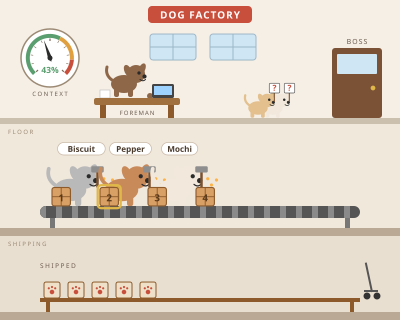

# Dog Factory

A Claude Code mod that keeps a pane of cute animated dogs working a factory beside your chat. The factory is your work board: open asks (what Claude is waiting on you for), next steps, and work shipped by subagents, with the context window's fill on a gauge on the wall and a per-category breakdown underneath. The scene is three floors tall (office, factory floor, shipping dock) and scales to the pane's width.



## What you see

- **The foreman dog** at the front desk types while Claude works a turn and sleeps with drifting z's when idle.
- **Worker dogs** appear at the belt for each running subagent, hammering with wagging tails. Each gets a name picked from its id (Biscuit, Pepper, Waffles, Mochi, Noodle, Pickles, Olive, Scout, Peanut, Maple, Clover, Ziggy).
- **Crates on the belt** are your next steps, numbered to match the list below. A step you sent to the prompt glows.
- **Dogs holding "?" signs** wait at the boss's door for each open ask.
- **Paw-stamped boxes** on the Shipped shelf are tasks subagents finished.
- **The wall gauge** shows how full the context window is. Under the scene: tokens used of the window and where auto-compaction kicks in, then one row per category as `/context` lists them (system prompt, tools, MCP tools, memory files, messages, free space), then the 5-hour and 7-day rate-limit windows and the session's cost so far. The breakdown is a local estimate and sends no request.
- An empty board shows one dog asleep in a basket with the lights dimmed.

In a terminal the scene is drawn in text and animates twice a second.

## How items get in

- Claude gets a `track` tool and a short system-prompt section telling it when to use it: when it asks you a question or needs a decision (an ask), when it names follow-up work it is not doing now (a step), and when you answer or a step is finished (done).
- Subagent work is captured automatically from each agent's completion, with a toast like `Biscuit shipped: Review the diff`.

## What you can do in the pane

- **Done** and **Drop** on every ask and step.
- **To prompt** on a step puts `Do: <step>` in the prompt box for you to send. The step is then marked in progress, and Claude marks it done when it finishes.

## Commands

- `/factory` opens the pane.
- `/factory add ask <text>` and `/factory add step <text>` add by hand.
- `/factory clear` removes finished rows.

The board is stored per working directory, so another session in the same project sees the same board. Finished rows are pruned after a day.

## Install

At the prompt of a terminal session:

```
/plugin install dog-factory --marketplace abehrman/claude-mod-dog-factory
```

Answer `y` to add the marketplace, then pick a scope (user is first). From a shell:

```
claude plugin install dog-factory --marketplace abehrman/claude-mod-dog-factory
```

In the desktop app, where `/plugin` does not run: click + next to the prompt box, then Plugins, Add marketplace with `abehrman/claude-mod-dog-factory`, then Add plugin.

The pane a mod opens by itself at startup stays undrawn until you ask for it: run `/factory` once and it docks beside the conversation.

## Developing

```
npx -y @anthropic-ai/claude-code@2.1.317 plugin validate .
npx -y @anthropic-ai/claude-code@2.1.317 plugin test .
```

The mod is a Claude Code function-hooks plugin: `hooks/register.tsx` wires the events, `hooks/board.ts` is the pure board logic, `hooks/scene-svg.ts` draws the animated SVG scene for desktop, VS Code and mobile, and `hooks/scene-ascii.ts` draws the terminal scene. `types/index.d.ts` is the state contract.

## License

MIT
